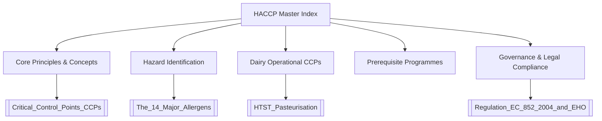

---
tags:
  - moc
  - haccp
  - food-safety
  - dairy
created: 2026-09-30
status: complete
---

# 🗺️ HACCP Level 2 Master Map of Content (MOC)

Welcome to the **HACCP Level 2 Training Second Brain**, tailored specifically for food and dairy manufacturing operations. This knowledge base serves as a single source of truth for principles, hazards, operational Critical Control Points (CCPs), Prerequisite Programmes (PRPs), and regulatory compliance.

---

## 📚 Navigation by Knowledge Domains

### 1. Core Principles & System Design
- [[What_is_HACCP]] — Definition, history (NASA to Codex), and preventive philosophy.
- [[7_HACCP_Principles]] — The complete Codex Alimentarius 7-step methodology.
- [[Critical_Control_Points_CCPs]] — Methodology, process mapping, and decision trees.
- [[Critical_Limits]] — Boundary values separating safe from unsafe food.
- [[Monitoring_Procedures]] — Real-time tracking and automated divert routines.
- [[Corrective_Actions_PDCA]] — Root cause analysis and the continuous improvement cycle.
- [[Verification_and_Record_Keeping]] — Audits, calibrations, and statutory log retention.

### 2. Hazard Identification & Controls
- [[Biological_Hazards_and_Microbiology]] — Pathogens, vegetative cells, and spore formers.
- [[Chemical_Hazards_and_CIP]] — Cleaning agents, CICs, and cross-contamination prevention.
- [[Physical_Hazards_and_Foreign_Bodies]] — Glass policy, plastics, metals, and filtration.
- [[The_14_Major_Allergens]] — UK & EU statutory declarations and nut-free site enforcement.

### 3. Dairy Processing & Operational CCPs
- [[Raw_Milk_Reception_and_Filtration]] — Tanker intake deck and 1000µm particulate filters (CCP 1).
- [[HTST_Pasteurisation]] — Continuous thermal kill steps: >72°C for 15s (CCP 2).
- [[Chilling_and_Spore_Control]] — Rapid cooling to <8°C within 90 min (CCP 3).
- [[Metal_Detection_in_Dairy]] — End-of-line packaging inspection for cheese and yogurts (CCP 4).
- [[Microbiological_KPIs_Dairy]] — Batch release limits (TVC, Enteros, Salmonella, Listeria).

### 4. Prerequisite Programmes & Hygiene
- [[Prerequisite_Programmes_PRPs]] — The 7 foundational pillars of food safety.
- [[Personal_Hygiene_and_Handwashing]] — 20-second hand hygiene protocol and PPE.
- [[Factory_Zoning_and_Pen_Colour_Coding]] — High-Care / High-Risk zoning and pen colours.
- [[4_Point_Container_Labelling]] — Mandatory storage identification standard.

### 5. Governance, Team & Legal Liabilities
- [[Regulation_EC_852_2004_and_EHO]] — Statutory framework and Environmental Health powers.
- [[HACCP_Team_and_Quarantine_ON_HOLD]] — Multidisciplinary team roles and ON-HOLD tags.
- [[Knowledge_Assessment_Quiz]] — Guided review of the 10 core certification questions.

---
> [!TIP]
> Use `Cmd + Click` on any `[[Wikilink]]` above to jump directly into the detailed concept note.
