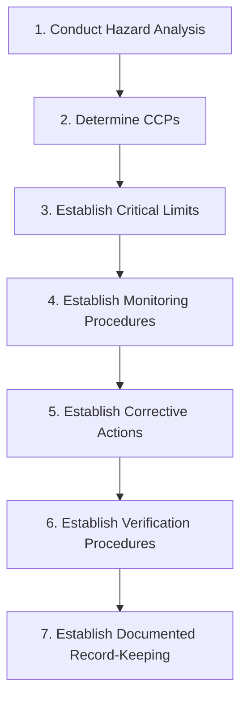

---
tags:
  - concept
  - haccp-core
  - codex
created: 2026-09-30
status: complete
---

# ⚡ The 7 Principles of HACCP

Under the international guidelines established by **Codex Alimentarius**, the HACCP system is built upon **seven fundamental principles**:

---

## 📋 Breakdown of the Principles

### Principle 1: Conduct a Hazard Analysis
Identify all potential biological, chemical, physical, and allergen hazards associated with every step of the processing flow diagram.
- See: [[Biological_Hazards_and_Microbiology]], [[Chemical_Hazards_and_CIP]], [[Physical_Hazards_and_Foreign_Bodies]], [[The_14_Major_Allergens]].

### Principle 2: Determine Critical Control Points (CCPs)
Locate the specific operational points, steps, or procedures where controls are essential to prevent, eliminate, or reduce significant hazards to acceptable levels.
- See: [[Critical_Control_Points_CCPs]].

### Principle 3: Establish Critical Limits
Set measurable minimum and maximum criteria (e.g., temperature, time, pH, micron size) that must be met to separate safe product from unsafe product.
- See: [[Critical_Limits]], [[HTST_Pasteurisation]].

### Principle 4: Establish Monitoring Procedures
Create planned observations and continuous testing (e.g., flow divert sensors, temperature charts) to ensure CCPs stay strictly within critical limits.
- See: [[Monitoring_Procedures]].

### Principle 5: Establish Corrective Actions
Define immediate actions to bring the process back under control, quarantine non-conforming product, and eliminate root causes when monitoring indicates a deviation.
- See: [[Corrective_Actions_PDCA]], [[HACCP_Team_and_Quarantine_ON_HOLD]].

### Principle 6: Establish Verification Procedures
Perform audits, equipment calibrations, and microbiological tests to confirm the HACCP system is operating effectively.
- See: [[Verification_and_Record_Keeping]], [[Microbiological_KPIs_Dairy]].

### Principle 7: Establish Record-Keeping & Documentation
Maintain comprehensive, tamper-proof logs, calibration certificates, and training records proving safety controls were executed.
- See: [[Verification_and_Record_Keeping]].

---
**Related Notes:**
- [[What_is_HACCP]]
- [[Critical_Control_Points_CCPs]]
- [[Critical_Limits]]
- [[HACCP_Master_Index]]
