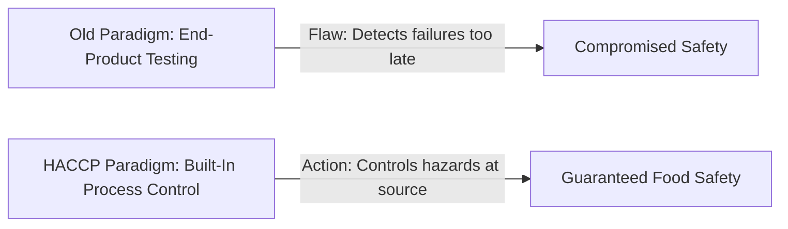

---
tags:
  - concept
  - haccp-core
  - history
created: 2026-09-30
status: complete
---

# 📖 What is HACCP?

**HACCP** stands for **Hazard Analysis Critical Control Point**. It is an internationally recognized, science-based food safety management system designed to **prevent, reduce, or eliminate** biological, chemical, physical, and allergen hazards before products reach consumers.

---

## 🚀 Historical Origins

HACCP was developed in the 1960s through a landmark collaboration:
1. **1960s Space Race**: **NASA**, the **U.S. Army Laboratories**, and the **Pillsbury Company** created the system to guarantee 100% safe, crumb-free, and pathogen-free food for astronauts on manned spaceflights.
2. **1970s Industrial Adoption**: The **US FDA** adopted HACCP principles for commercial canned food manufacturing.
3. **1990s Global Standardisation**: The [[Regulation_EC_852_2004_and_EHO|Codex Alimentarius Commission]] adopted HACCP as the international benchmark.
4. **2000s Mandatory Statutory Law**: Made compulsory across the UK and EU under **Regulation (EC) No 852/2004**.

---

## 🎯 The Preventive Philosophy

Instead of relying on random batch inspection of finished goods, HACCP establishes continuous process control:
- Identifies critical steps where control is essential: [[Critical_Control_Points_CCPs]].
- Defines safe operational boundaries: [[Critical_Limits]].
- Enforces instant deviation actions: [[Corrective_Actions_PDCA]].
- Relies on strong operational foundations: [[Prerequisite_Programmes_PRPs]].

> [!IMPORTANT]
> A food business cannot legally trade in the dairy sector without an active, validated, and documented HACCP plan.

---
**Related Notes:**
- [[7_HACCP_Principles]]
- [[Critical_Control_Points_CCPs]]
- [[Regulation_EC_852_2004_and_EHO]]
- [[HACCP_Master_Index]]
