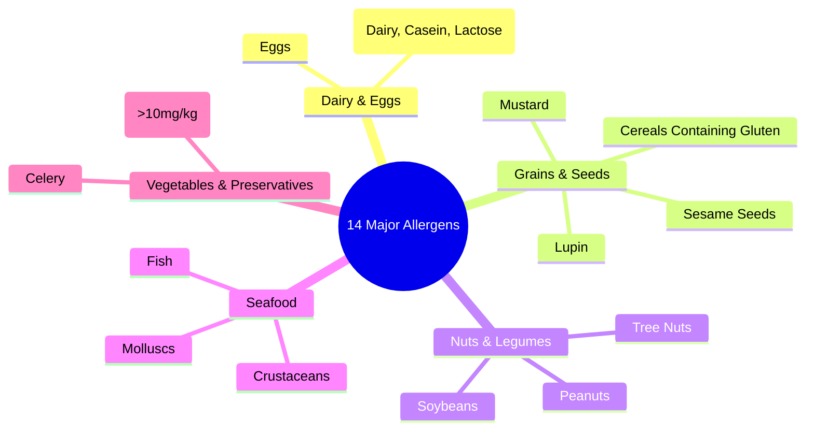

---
tags:
  - hazards
  - allergens
  - law
  - compliance
created: 2026-09-30
status: complete
---

# ⚠️ The 14 Major Food Allergens

Under UK and EU statutory regulations (including FIC Regulation 1169/2011 and [[Regulation_EC_852_2004_and_EHO|Regulation (EC) 852/2004]]), food businesses are legally required to declare the presence of **14 major allergens** used as ingredients.

---

## 📋 The 14 Statutory Allergens

1. **Celery**: Stalks, leaves, seeds, and celeriac roots.
2. **Cereals Containing Gluten**: Wheat (spelt, Khorasan), rye, barley, and oats.
3. **Crustaceans**: Crabs, prawns, lobsters, and scampi.
4. **Eggs**: Liquid egg, egg powder, baked goods, glazes, and mayonnaise.
5. **Fish**: Fish sauces, smoked fish, and relishes.
6. **Lupin**: Lupin seeds and flour in specialty breads.
7. **Milk**: Milk, cream, butter, cheese, whey, casein, and lactose.
8. **Molluscs**: Mussels, oysters, squid, and snails.
9. **Mustard**: Liquid mustard, powder, and seeds.
10. **Peanuts**: Groundnuts and peanut oil.
11. **Sesame Seeds**: Burger buns, salads, and tahini.
12. **Soybeans**: Tofu, soy lecithin, and soy sauce.
13. **Sulphur Dioxide & Sulphites**: Food preservatives ($> 10\text{ mg/kg}$ in wine, fruit preparations).
14. **Tree Nuts**: Almonds, hazelnuts, walnuts, cashews, pecans, Brazil nuts, pistachios, macadamias.

---

## 🚫 Site Policies & Dairy Controls

- **Core Allergen on Site**: Milk is handled across all primary lines.
- **Recipe Segregation**: Where gluten (crumb toppings), egg (custards), or soya (chocolate coatings) are used, separate equipment schedules and full CIP clean-downs are mandatory.
- **Strict Nut-Free Site Policy**: Bringing peanuts, tree nuts, or sesame onto the premises is strictly forbidden for staff and contractors.

---
**Related Notes:**
- [[Factory_Zoning_and_Pen_Colour_Coding]]
- [[4_Point_Container_Labelling]]
- [[Prerequisite_Programmes_PRPs]]
- [[HACCP_Master_Index]]
