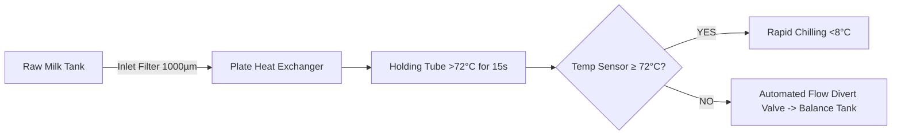

---
tags:
  - dairy-operations
  - ccp
  - thermal-kill
  - microbiology
created: 2026-09-30
status: complete
---

# 🔥 HTST Pasteurisation (CCP 2)

**High-Temperature Short-Time (HTST) Pasteurisation** is the primary biological kill step in liquid milk and dairy manufacturing. Its purpose is to destroy pathogenic vegetative bacteria—specifically *Listeria monocytogenes*, *Salmonella spp.*, and *Escherichia coli*.

---

## ⏱️ Critical Limits & Parameters

| Processing Matrix | Critical Limit | Holding Time | Target Organisms Eliminated |
| :--- | :--- | :--- | :--- |
| **Continuous Liquid Milk** | **$> 72.0^\circ\text{C}$** | $\ge 15\text{ seconds}$ | *Listeria, Salmonella, E. coli* |
| **Batch Pasteurised Dairy** | **$> 72.0^\circ\text{C}$** | $\ge 2.5\text{ minutes}$ | Vegetative pathogens |
| **Dessert Bases / Curds** | **$> 86.0^\circ\text{C}$** | $\ge 20\text{ minutes}$ | Pathogens & spoilage flora |

---

## 🚨 Automated Controls & Corrective Actions

1. **Automated Flow Divert Valve (FDV)**: If the temperature probe at the end of the holding tube detects a temperature below $72^\circ\text{C}$, the valve automatically diverts milk back to the balance tank. Unpasteurised milk is physically prevented from reaching forward stages.
2. **Immediate Escalation**: The operator must notify the [[HACCP_Team_and_Quarantine_ON_HOLD|Quality / Technical Team]] immediately.
3. **Quarantine**: Any downstream product is tagged **ON-HOLD**.
4. **Root Cause Analysis**: Apply [[Corrective_Actions_PDCA|PDCA]] to check steam pressure, plate integrity, and flow rates.

---
**Related Notes:**
- [[Raw_Milk_Reception_and_Filtration]] (CCP 1)
- [[Chilling_and_Spore_Control]] (CCP 3)
- [[Biological_Hazards_and_Microbiology]]
- [[Critical_Limits]]
- [[HACCP_Master_Index]]
