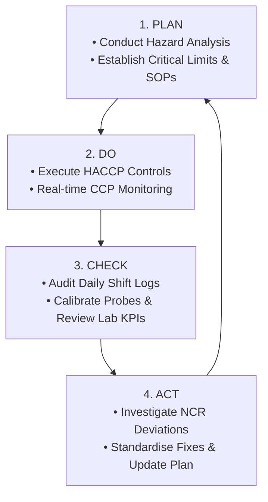

# Corrective Actions & The PDCA Cycle

## Overview
When a [[7_HACCP_Principles|Critical Limit]] is breached at any [[HTST_Pasteurisation|Critical Control Point]], immediate corrective action is mandatory to restore process control, quarantine suspect product, and prevent recurrence.

---

## The PDCA Continuous Improvement Cycle

---

## The 4-Step Corrective Action Workflow
1. **Immediate Line Containment**: Trigger automated flow divert valves or stop packaging conveyors immediately.
2. **Quarantine & Tagging**: Apply physical Yellow/Red **ON-HOLD** tags to affected pallets and lock lot numbers in ERP.
3. **Root Cause Analysis (RCA)**: Engineering and QA investigate the underlying failure (e.g., steam valve, seal failure).
4. **Disposition & Record**: Suspect product is either re-pasteurised, downgraded, or destroyed upon Quality Manager sign-off.

---

## Related Notes
- [[7_HACCP_Principles]]
- [[HTST_Pasteurisation]]
- [[Microbiological_KPIs_Dairy]]
- [[Regulation_EC_852_2004_and_EHO]]
- [[HACCP_Master_Index]]
