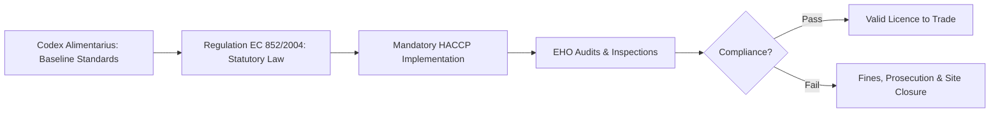

---
tags:
  - governance
  - law
  - compliance
  - uk-eu
created: 2026-09-30
status: complete
---

# ⚖️ Regulation (EC) 852/2004 & EHO Enforcement

In the United Kingdom, food hygiene and safety standards are governed by primary legislation enacted through **Regulation (EC) No 852/2004** (retained in UK law under the Food Hygiene Regulations).

---

## 🏛️ Statutory Mandate

1. **Mandatory Requirement**: Every food business operator (FBO) must put in place, implement, and maintain a permanent procedure based on the [[7_HACCP_Principles|HACCP principles]].
2. **Licence to Trade**: An FBO cannot legally operate or distribute food products without a validated HACCP plan.

---

## 👮 Environmental Health Officer (EHO) Powers

Local authority Environmental Health Officers (EHOs) inspect food processing premises to verify compliance. Under statutory law, EHOs possess the authority to:
- **Inspect Premises & Records**: Access all production logs, calibration records, and CCP thermographs without prior notice.
- **Issue Hygiene Improvement Notices (HIN)**: Legally binding notices requiring operational modifications within strict deadlines.
- **Hygiene Emergency Prohibition Notices (HEPN)**: Immediate legal shutdown of the factory if an imminent risk to public health is identified.
- **Criminal Prosecution**: Direct prosecution of the business and individual employees for severe breaches or record falsification.

> [!CAUTION]
> Under UK law, individual staff members can be held personally legally accountable for breaches of food hygiene legislation that lead to foodborne illness outbreaks.

---
**Related Notes:**
- [[What_is_HACCP]]
- [[7_HACCP_Principles]]
- [[HACCP_Team_and_Quarantine_ON_HOLD]]
- [[HACCP_Master_Index]]
